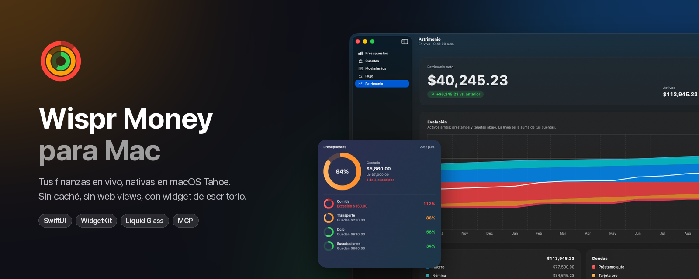
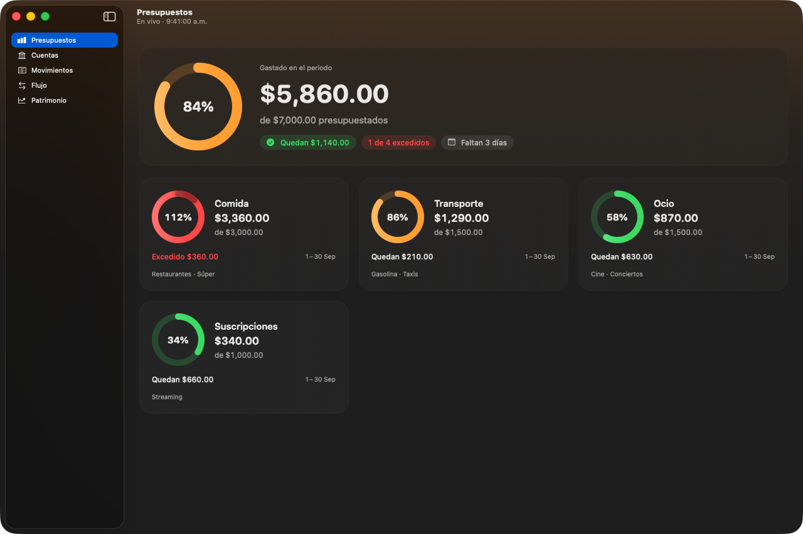
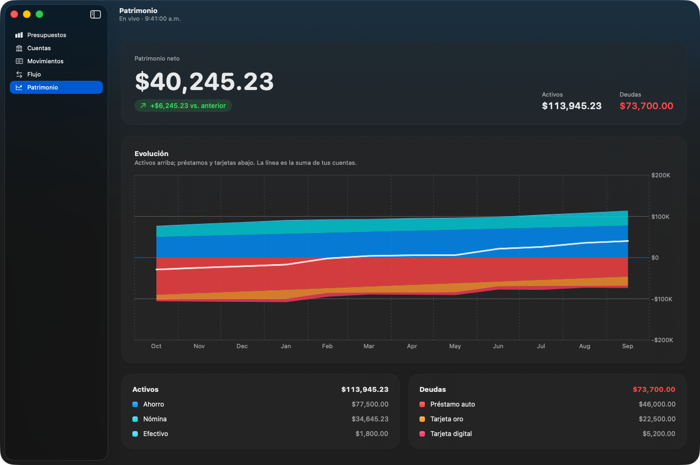
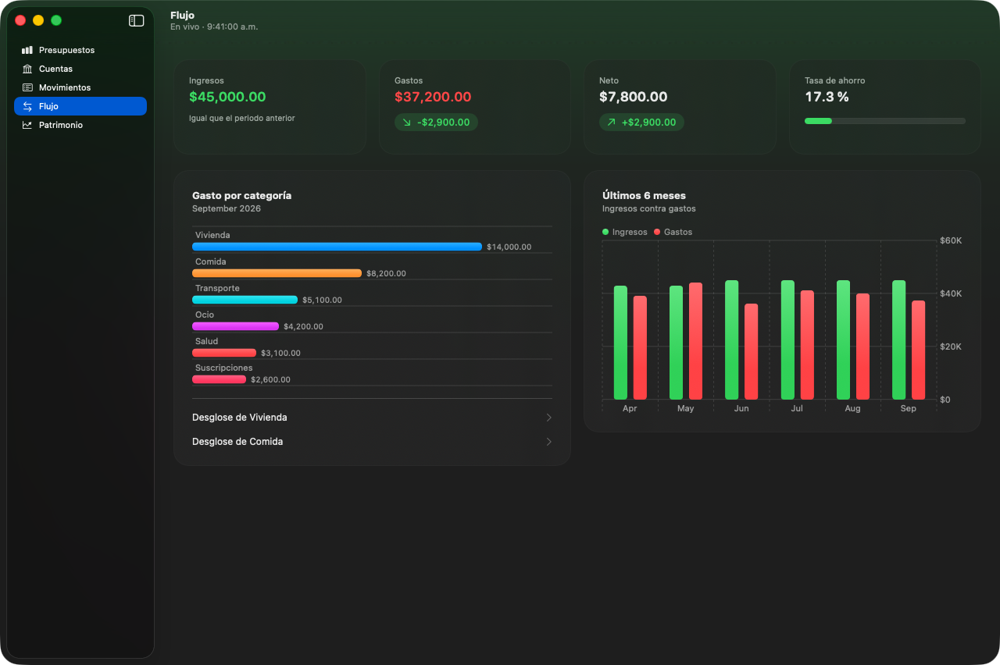
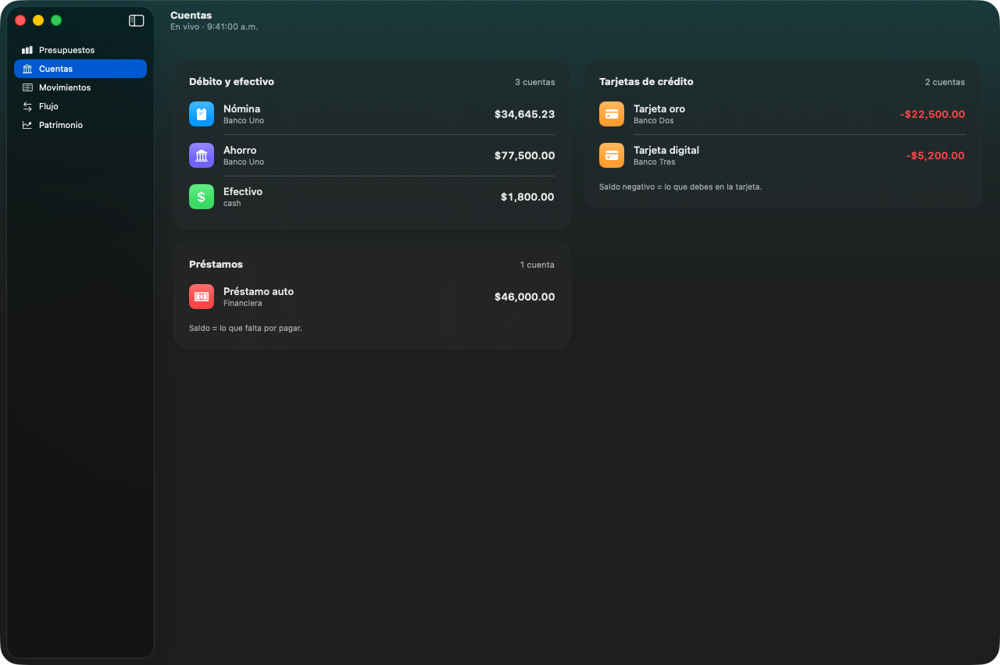
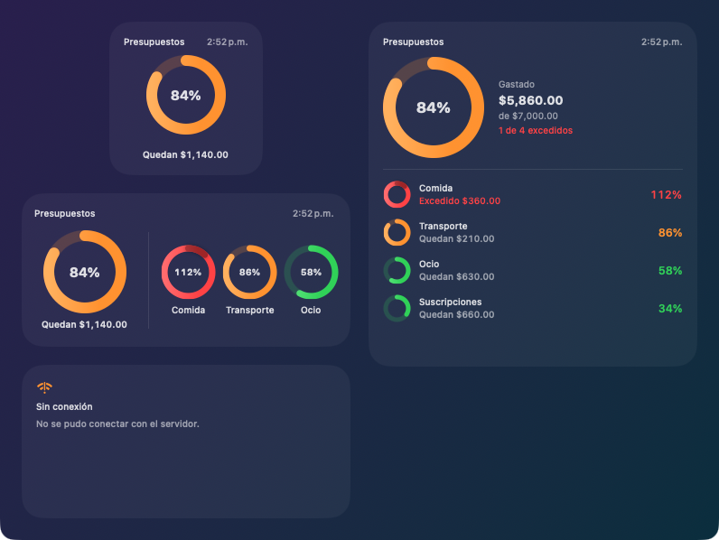
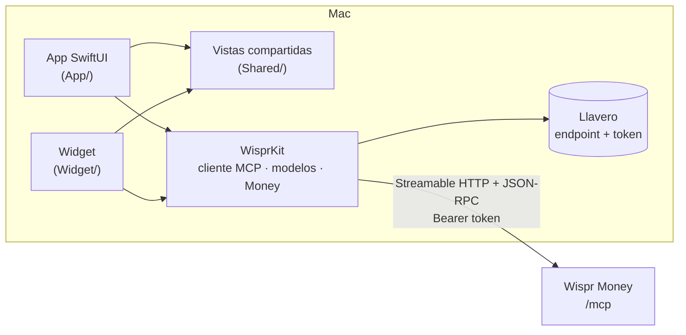

<div align="center">



# Wispr Money para Mac

**App nativa de macOS y widget de escritorio para [Wispr Money](#qué-es-wispr-money) self-hosted.**
SwiftUI puro, sin web views, sin caché: cada cifra se pide en vivo a tu servidor.

[](#requisitos)
[](https://swift.org)
[](#diseño)
[](#widget)
[](LICENSE)

[Pantallas](#pantallas) · [Widget](#widget) · [Principios](#principio-nada-pre-cacheado) · [Instalar](#compilar-e-instalar) · [Arquitectura](#arquitectura) · [Contribuir](#contribuir)

</div>

> [!NOTE]
> **In English:** a native macOS 26 (Tahoe) client and desktop widget for self-hosted Wispr Money.
> Pure SwiftUI + Swift Charts + WidgetKit, talking straight to the server's MCP endpoint
> (Streamable HTTP + JSON-RPC). No web views, no cache: every number is fetched live, and if a
> request fails you see the error, never stale figures. The UI is in Spanish; contributions in
> English are welcome.

> [!IMPORTANT]
> Cliente **no oficial**, hecho por la comunidad. No está afiliado ni respaldado por Wispr Money.

## Por qué

Wispr Money vive en el navegador. Esta app lo trae al escritorio como una app de Mac de verdad:
barra lateral translúcida, atajos de teclado, gráficas nativas y un widget que ves sin abrir nada.
Todo se consulta en vivo por MCP, el mismo endpoint que usan los asistentes de IA, así que no hay
backend extra ni base de datos local.

## Pantallas

<table>
  <tr>
    <td width="50%"></td>
    <td width="50%"></td>
  </tr>
  <tr>
    <td><b>Presupuestos</b>: resumen del periodo y anillos tipo Actividad. Al pasar del 100 % el anillo da una segunda vuelta.</td>
    <td><b>Patrimonio</b>: activos arriba, préstamos y tarjetas abajo, la suma como línea y el detalle de cada mes al pasar el cursor.</td>
  </tr>
  <tr>
    <td></td>
    <td></td>
  </tr>
  <tr>
    <td><b>Flujo</b>: ingresos, gastos, neto y tasa de ahorro contra el mes anterior, gasto por categoría con desglose y los últimos 6 meses.</td>
    <td><b>Cuentas</b>: débito, tarjetas y préstamos con su saldo más reciente.</td>
  </tr>
</table>

<sub>Todas las capturas usan datos sintéticos (`Shared/PreviewData.swift`).</sub>

| Sección | Atajo | Herramientas MCP |
|---|---|---|
| Presupuestos: % gastado, restante, excedido | ⌘1 | `list_budgets` |
| Cuentas: saldo de cada cuenta, por tipo | ⌘2 | `list_accounts` + `get_net_worth` (último punto) |
| Movimientos: búsqueda por mes, texto y cuenta; alta manual | ⌘3 · ⌘N | `search_transactions`, `create_transaction`, `list_categories` |
| Flujo: ingresos, gastos, neto, tasa de ahorro, categorías, tendencia | ⌘4 | `get_cashflow`, `spending_by_category` |
| Patrimonio: total contra el periodo anterior, evolución por cuenta | ⌘5 | `get_net_worth` |

Actualizar en cualquier pantalla: ⌘R.

## Widget



Widget **Presupuestos** en tamaño pequeño, mediano y grande: anillo del total del periodo y los
presupuestos más excedidos primero (verde < 80 %, naranja 80–100 %, rojo > 100 %).

Soporta el **modo tintado y de vidrio** de macOS 26. En esos modos el sistema aplana los colores a
blanco, así que el exceso también se lee por la forma y la opacidad del anillo, no solo por el color.

## Principio: nada pre-cacheado

- Cada pantalla consulta al servidor al abrirse, cada 60 s mientras está visible y con ⌘R. El
  subtítulo de la ventana dice a qué hora fue la última consulta.
- Sesión HTTP efímera, sin `URLCache`, con `reloadIgnoringLocalAndRemoteCacheData`.
- Si una consulta falla se muestra el error, nunca los números de la consulta anterior.
- Lo único que se guarda en la Mac es el endpoint y el token, en el Llavero.

**Límite del widget (lo impone macOS):** un widget no puede tener una conexión viva. El sistema le
pide una "foto" y la muestra hasta la siguiente. Aquí cada foto se pide en vivo a Wispr
(`list_budgets`); se renueva cada ~15 min (según el presupuesto de refrescos de macOS) y cada vez
que abres la app. Muestra la hora de consulta y, si no hay red, "Sin conexión" en vez de cifras viejas.

## Diseño

Pensada para macOS 26 Tahoe: la barra lateral y la toolbar usan Liquid Glass; el contenido va en
tarjetas de material sobre un fondo con el tinte de cada sección. Las gráficas son Swift Charts,
con selección por cursor. Cada pantalla se separa en carga en vivo (`XView`) y contenido puro
(`XContent`) con `#Preview` y datos sintéticos, así el diseño se itera sin tocar el servidor.

## Requisitos

- macOS 26 Tahoe o posterior.
- Xcode 26 completo (el widget es una extensión que solo Xcode empaqueta y firma) y
  [XcodeGen](https://github.com/yonaskolb/XcodeGen).
- Un servidor Wispr Money self-hosted con el endpoint MCP (`https://<tu-host>/mcp`) y un token.

## Compilar e instalar

1. Instala Xcode y ejecuta `sudo xcode-select -s /Applications/Xcode.app`.
2. Xcode → Settings → Accounts: agrega tu Apple ID (el equipo personal gratuito basta).
3. Crea `Config/Team.local.xcconfig` con tu Team ID (está en `.gitignore`):
   ```
   WISPR_TEAM_ID = ABCDE12345
   ```
   El Team ID aparece en Xcode → Settings → Accounts → tu equipo. App y widget lo necesitan para
   compartir el token por un grupo de Llavero.
4. Genera el proyecto y compila:
   ```sh
   brew install xcodegen
   xcodegen generate && open WisprMac.xcodeproj   # ▶︎ con el esquema WisprMac
   ```
5. Para que macOS registre el widget, instala la app en `/Applications`.
6. En la app, pega el endpoint y el token. La conexión se prueba antes de guardar nada.
7. Agrega el widget: clic derecho en el escritorio → Editar widgets → "Presupuestos".

Si tu servidor solo es accesible por una VPN (Tailscale, WireGuard…), conéctate antes.

## Arquitectura



```
WisprKit/   paquete SPM: cliente MCP, modelos, dinero, Llavero (+ tests, + wispr-probe)
App/        app SwiftUI
Widget/     extensión WidgetKit
Shared/     vistas y datos de preview compartidos por la app y el widget
docs/       banner y capturas del README (generadas con scripts/make-docs-images.py)
project.yml definición del proyecto para XcodeGen (el .xcodeproj no se versiona)
```

Los montos viajan en unidades menores (`Money`) y la moneda sale de cada respuesta, nunca se
hardcodea. `wispr-probe` verifica la conexión desde la terminal sin Xcode.

## Tests

```sh
./scripts/test.sh
```

Usa `swift test`. Con solo Command Line Tools, el script agrega las banderas para encontrar Swift
Testing. Los tests usan fixtures sintéticos y un servidor MCP simulado (`URLProtocol`); no tocan
el servidor real ni contienen datos financieros reales.

## Privacidad

- No hay analítica, telemetría ni servidores de terceros: la app habla solo con tu servidor.
- No se guardan montos en disco (ni `UserDefaults`, ni app group, ni archivos).
- El token vive en el Llavero de macOS y nunca se imprime.

## Qué es Wispr Money

Una app de finanzas personales que puedes alojar en tu propio servidor y que expone sus datos por
MCP (Model Context Protocol). Este repo es solo un cliente para Mac; necesitas tu propia
instancia.

## Contribuir

Issues y PRs son bienvenidos: revisa los [issues abiertos](../../issues), sobre todo los marcados
[`good first issue`](../../issues?q=is%3Aissue+is%3Aopen+label%3A%22good+first+issue%22).
Antes de abrir un PR lee [CONTRIBUTING.md](CONTRIBUTING.md). La regla más importante: **nunca
subas datos financieros reales**, ni en capturas, ni en tests, ni en fixtures.

Si te sirve, deja una ⭐: ayuda a que otros usuarios de Wispr Money encuentren la app.

## Licencia

[MIT](LICENSE)
